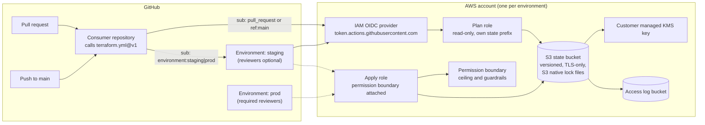

# aws-iac-foundations

[](https://github.com/adrianabelgarcia/aws-iac-foundations/actions/workflows/ci.yml)


The shared foundation for an AWS platform managed with Terraform and GitHub Actions. Every other repository in the platform depends on it for three things:

1. **Remote state**: an encrypted, versioned, locked S3 backend per AWS account, with no DynamoDB table.
2. **Keyless delivery**: GitHub Actions authenticates to AWS through OIDC, with one read-only plan role and one apply role per repository, and every apply role bounded by a permission boundary.
3. **A pipeline standard**: a reusable workflow that runs static checks, plans, evaluates policy-as-code against the plan, and applies exactly the plan that was reviewed.

It also ships reusable Terraform modules (`modules/tags`, `modules/vpc`) and the policies that enforce the platform's guardrails.

## The problem it solves

| Concern | Typical state in a growing team | What this repository provides |
| --- | --- | --- |
| State | Ad-hoc buckets, no locking, state shared between accounts | One bucket per account: SSE-KMS with a CMK, versioning, TLS-only policy, public access blocked, access logs, lifecycle rules, S3 native locks |
| Credentials | Long-lived IAM user keys stored in GitHub secrets | Short-lived OIDC sessions (1 hour), trust limited to exact repository, branch or environment claims |
| Delivery | Each repository copies a pipeline and drifts | One reusable workflow, versioned with `@v1`, with the same checks everywhere |
| Review | "The plan looked fine" | The plan is posted to the pull request, policy-checked, uploaded, and applied byte for byte |
| Guardrails | Reviewers catch missing tags and open ports by eye | Rego policies run against `terraform show -json` and fail the pipeline |
| Blast radius | CI roles can grant themselves anything | Permission boundary with explicit denies for IAM escalation, governance, security tooling and state tampering |

## Architecture



Solid arrows are normal flow. Dotted arrows show that a GitHub environment's protection rules must pass before GitHub issues the token that assumes the apply role.

## Repository layout

| Path | Purpose |
| --- | --- |
| `bootstrap/` | Root that creates the state KMS key, state bucket and access log bucket. Run once per account. |
| `github-oidc/` | Root that creates the OIDC provider, the permission boundary, and a plan and an apply role per consuming repository. |
| `modules/tags/` | Standard tag set with validation, plus the cost allocation keys. Tested offline. |
| `modules/vpc/` | Opinionated wrapper around `terraform-aws-modules/vpc`: three AZs, NAT policy by environment, flow logs with a CMK, default security group emptied, VPC endpoints for S3, ECR, STS, SSM and CloudWatch Logs. Tested offline. |
| `policies/` | Rego policies for required tags, S3 exposure, world-open ingress, and encryption. Unit tests and plan fixtures included. |
| `.github/workflows/terraform.yml` | The reusable workflow (contract below). |
| `.github/workflows/ci.yml` | This repository's CI. Calls the reusable workflow locally and runs module, policy and workflow tests. No AWS credentials. |
| `docs/adr/` | Architecture decision records (MADR). |

## Using it from another repository

```yaml
name: terraform

on:
  pull_request:
  push:
    branches: [main]

permissions:
  contents: read
  id-token: write
  pull-requests: write

jobs:
  staging:
    uses: adrianabelgarcia/aws-iac-foundations/.github/workflows/terraform.yml@v1
    with:
      working-directory: environments/staging
      environment: staging
      aws-region: us-east-1
      aws-role-arn: ${{ vars.AWS_STAGING_PLAN_ROLE_ARN }}
      aws-apply-role-arn: ${{ vars.AWS_STAGING_APPLY_ROLE_ARN }}
      apply: ${{ github.ref == 'refs/heads/main' }}

  prod:
    needs: staging
    uses: adrianabelgarcia/aws-iac-foundations/.github/workflows/terraform.yml@v1
    with:
      working-directory: environments/prod
      environment: prod
      aws-region: us-east-1
      aws-role-arn: ${{ vars.AWS_PROD_PLAN_ROLE_ARN }}
      aws-apply-role-arn: ${{ vars.AWS_PROD_APPLY_ROLE_ARN }}
      apply: ${{ github.ref == 'refs/heads/main' }}
```

The role ARNs come from the `apply_role_arns` and `plan_role_arns` outputs of `github-oidc/`. Store them as repository or environment variables.

Each consuming root needs a `backend.hcl` and a state key that starts with the repository name, for example `aws-eks-platform/staging/terraform.tfstate`. The IAM policies scope each repository's access to its own prefix.

### Reusable workflow contract (v1)

| Input | Type | Required | Default | Meaning |
| --- | --- | --- | --- | --- |
| `working-directory` | string | yes | | Terraform root, relative to the repository root |
| `environment` | string | yes | | GitHub environment for the apply job. Its protection rules gate applies. |
| `aws-region` | string | no | `us-east-1` | Region for credentials and the default provider region |
| `aws-role-arn` | string | no | `""` | Read-only plan role. When empty, plan and apply are skipped and only static checks run. |
| `aws-apply-role-arn` | string | no | `""` | Write role for apply. Falls back to `aws-role-arn` when empty. Optional addition, see ADR 0003. |
| `apply` | boolean | no | `false` | Apply the saved plan. Pass true only for pushes to the default branch. |
| `terraform-version` | string | no | `1.12.0` | Terraform CLI version |

| Job | Runs when | What it does |
| --- | --- | --- |
| `static` | always | `terraform fmt -check -recursive`, `init -backend=false`, `validate`, tflint with the repository's `.tflint.hcl`, checkov with `.checkov.yaml` (hard fail) |
| `plan` | `aws-role-arn` is set and static passed | OIDC login, `init -backend-config=backend.hcl`, `plan -out=tfplan`, conftest against the plan JSON, sticky pull request comment, plan artifact upload |
| `apply` | `aws-role-arn` is set and `apply` is true | Runs in the `environment`, downloads the reviewed plan artifact, applies that plan without re-planning |

The caller must grant `id-token: write`, `contents: read` and `pull-requests: write`.

### Shared modules

```hcl
module "tags" {
  source = "git::https://github.com/adrianabelgarcia/aws-iac-foundations.git//modules/tags?ref=v1"

  project     = "aws-eks-platform"
  environment = "prod"
  owner       = "platform-sre"
  cost_center = "PLAT-1024"
  repository  = "adrianabelgarcia/aws-eks-platform"
}

provider "aws" {
  region = "us-east-1"
  default_tags {
    tags = module.tags.tags
  }
}

module "vpc" {
  source = "git::https://github.com/adrianabelgarcia/aws-iac-foundations.git//modules/vpc?ref=v1"

  name               = "eks-prod"
  environment        = "prod"
  region             = "us-east-1"
  availability_zones = ["us-east-1a", "us-east-1b", "us-east-1c"]
  cidr_block         = "10.40.0.0/16"
  tags               = module.tags.tags
}
```

Prod uses one NAT gateway per AZ and places interface endpoints in every private subnet. Other environments use one NAT gateway and one endpoint subnet to control hourly cost. The module tags private subnets for the internal load balancer controller and public subnets for the external one.

## Policies

Policies run with [conftest](https://www.conftest.dev) against `terraform show -json` output, so they see computed values, `default_tags` and module internals. They are Rego v1 and live in `policies/`:

| Package | Rule |
| --- | --- |
| `foundations.tags` | Every taggable resource has non-empty `Project`, `Environment`, `Owner`, `CostCenter`, `DataClassification` and `ManagedBy` in `tags_all` |
| `foundations.s3` | Public access blocks turn on all four protections; every bucket has a public access block; no canned public ACLs; no bucket policy that allows everyone without a condition |
| `foundations.network` | No `0.0.0.0/0` or `::/0` ingress except TCP 80 and TCP 443. Checks inline security group rules, `aws_security_group_rule` and `aws_vpc_security_group_ingress_rule` |
| `foundations.encryption` | Every bucket has default encryption (warns on SSE-S3). EBS, EFS and RDS storage is encrypted. Customer managed symmetric keys rotate |

Checks that depend on values unknown at plan time are skipped and run again on the next plan, so they never fail on a value that does not exist yet. The policies are tested with `opa test` and checked against a compliant and a violating plan fixture in both CI and `make policy-test`.

## Security model of the OIDC roles

Each consuming repository gets two roles. Both trust only the GitHub OIDC provider and require:

- `aud` equal to `sts.amazonaws.com`;
- `repository_owner` equal to the configured owner;
- `sub` equal to one of an explicit list. No wildcards.

| Role | Trusted `sub` claims | Can do | Cannot do |
| --- | --- | --- | --- |
| Plan (`<org>-gha-<repo>-plan`) | `repo:<owner>/<repo>:pull_request`, `repo:<owner>/<repo>:ref:refs/heads/main` | Read everything (`ReadOnlyAccess`). Read its own state prefix. Write `*.tflock` under its prefix. Decrypt state with the CMK. | Write any resource. Read secret values (explicit deny). Touch other repositories' state. |
| Apply (`<org>-gha-<repo>-apply`) | `repo:<owner>/<repo>:environment:<env>` for each declared environment | Manage allowlisted services and `<org>-*` IAM names. Read and write its own state prefix. Use the state key. | Exceed the permission boundary. Touch other repositories' state. Modify CI roles or the boundary. |

The apply role's token is only issued after its GitHub environment's protection rules pass. Set required reviewers on `prod` and a deployment branch rule for `main` in each consuming repository. That setting lives in GitHub, not in this code.

### Permission boundary

`<org>-gha-permission-boundary` is attached to every apply role and is the ceiling for everything CI creates. It allows a service allowlist and scoped IAM, and it denies:

- changes to CI roles and to the boundary policy itself;
- `iam:CreateRole` and `iam:PutRolePermissionsBoundary` unless the boundary is attached, which bounds every role CI creates;
- identity creation (users, access keys, login profiles) and trust changes (OIDC and SAML providers);
- Organizations, billing and account changes;
- turning off CloudTrail, AWS Config, GuardDuty, Security Hub or account-level S3 public access blocks;
- destructive changes to the state bucket and key, and any S3 or KMS access to state by a principal that is not an apply role;
- regional actions outside the configured region, except for global services.

### State

The state bucket enforces TLS-only access, SSE-KMS with a customer managed key that rotates, versioning, public access blocks, server access logs, and lifecycle rules that expire noncurrent versions while keeping the ten most recent. Lock files are ordinary objects under the same key, so they inherit those controls.

## How to run

Requirements: Terraform 1.10 or later (CI uses 1.12.0), tflint 0.66, checkov, OPA 1.22, conftest 0.71, actionlint 1.7 and, for the bootstrap only, AWS credentials for the target account.

Local checks, the same ones CI runs:

```bash
make check     # fmt, validate, tflint, checkov, terraform test, opa test, conftest fixtures
make lock      # regenerate provider lock files for linux_amd64 and darwin_arm64
```

Bootstrap an account (once per account, run by an administrator):

```bash
cd bootstrap
terraform init -backend=false              # first apply uses local state
terraform apply                             # terraform.tfvars targets the staging account
terraform init -migrate-state -backend-config=backend.hcl

cd ../github-oidc
terraform init -backend-config=backend.hcl
terraform apply
```

For the production account, use `backend.prod.hcl` and `prod.tfvars` in the same way, with production credentials. The `allowed_account_ids` guard in each provider refuses to run against any other account.

## CI

`.github/workflows/ci.yml` runs on every pull request and every push to `main`. None of its jobs needs AWS credentials.

| Job | Checks |
| --- | --- |
| `actionlint` | Workflow syntax and expressions |
| `bootstrap`, `github-oidc`, `module-tags`, `module-vpc` | The reusable workflow with an empty `aws-role-arn`: fmt, validate, tflint, checkov |
| `terraform-test` | `terraform test` for each module, with `mock_provider` and no credentials |
| `policy-tests` | `opa test -v policies/` |
| `policy-fixtures` | Compliant plan passes conftest; violating plan fails |

The module tests cover success paths (NAT and endpoint placement, endpoint set, KMS creation) and rejected inputs (CIDR size and range, AZ count, reserved tags, invalid owner). The policy tests cover each rule's positive and negative cases.

## Design decisions

- [ADR 0001](docs/adr/0001-s3-native-state-locking.md): S3 native locking (`use_lockfile`) instead of a DynamoDB table.
- [ADR 0002](docs/adr/0002-oidc-instead-of-static-keys.md): GitHub OIDC instead of IAM access keys.
- [ADR 0003](docs/adr/0003-reusable-workflows-and-policy-as-code.md): reusable workflow and policy-as-code as the platform standard.
- [ADR 0004](docs/adr/0004-permission-boundary-for-ci-roles.md): permission boundary as the ceiling for CI roles.

## Known gaps and accepted risks

- **Single-region state.** The state bucket is not replicated. Checkov's replication check is skipped inline with that reason. Recovery uses object versions. A DR replica is a follow-up.
- **Policies see the plan, not the account.** They evaluate what Terraform intends to change. Drift that already exists in the account is not detected here.
- **Broad allowlist.** The boundary grants service-level wildcards for the services the platform uses. Narrowing to actions is a follow-up that needs usage data.
- **No live AWS in this repository's CI.** By design there are no credentials here. The modules are tested with mocks, and the roots are validated offline. A first apply against a real account is the acceptance test for the roots.
- **Repository settings are outside this code.** Environment protection rules, repository variables for role ARNs, and the `v1` tag must be configured in GitHub.

## Contributing

See [CONTRIBUTING.md](CONTRIBUTING.md). Changes to the workflow contract need a new major version. Commits follow Conventional Commits.

## License

MIT. See [LICENSE](LICENSE).
